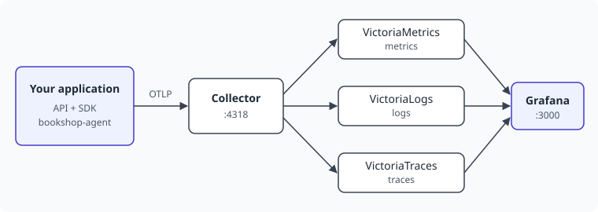

# OpenTelemetry Concepts

OpenTelemetry is an open standard for producing telemetry, together with the libraries and
tools that implement it. It's not a backend: it stores nothing and draws no charts. Its job
is to get well-formed data out of your application and to whichever tool you choose, so
that changing that tool doesn't mean changing your code.

## Learning objectives

By the end of this module, you'll be able to:

- [ ] Explain what traces, metrics and logs are each good for
- [ ] Tell the API from the SDK, and say why they're separate
- [ ] Describe the path telemetry takes through the workshop stack
- [ ] Emit all three signals by hand

## The three signals

Each signal answers a different kind of question.

| Signal | What it is | Good for |
|---|---|---|
| **Metrics** | Numbers aggregated over time | How much, how often, how fast. Cheap to keep, and made for dashboards and alerts |
| **Logs** | Timestamped records of something that happened | The details of one event |
| **Traces** | The steps of one operation, as a tree of spans | Where time went, and how one step led to another |

A **span** is one step in a trace, such as a database query, with a start, an end, and
attributes. Spans in a trace form a tree, because each one remembers its parent.

All three signals carry **attributes**: key and value pairs such as
`http.response.status_code=200`. Attributes are what let you filter and group your data.

### Instruments

Metrics are recorded through instruments, and the choice of instrument depends on what the
number means:

| Instrument | Use it for | Example |
|---|---|---|
| Counter | Something that only adds up | Requests served, tokens spent |
| Histogram | The distribution of a value | Request duration |
| Gauge | A value at a moment in time | Memory in use |
| UpDownCounter | Something that goes up and down | Items in a queue |

### Resources

A **resource** describes what is producing the telemetry, for example with
`service.name=bookshop-agent`. It's attached to everything that the application emits, so
you never need to repeat it on each attribute set.

## The API and the SDK

OpenTelemetry splits its libraries in two.

- The **API** is what instrumented code calls: start a span, add to a counter. On its own it
  does nothing, and it's cheap and safe to call.
- The **SDK** is the implementation. It decides what gets kept, batches the data, and sends
  it somewhere. The application configures it once, at startup.

This split lets a library use the API without forcing any choice on its users. If an
application never sets up an SDK, every API call becomes a no-op.

## How telemetry travels

Applications send telemetry using **OTLP**, the OpenTelemetry protocol. They could send it
straight to a backend, but usually it goes to the **Collector** first. The Collector is a
standalone service that receives telemetry, processes it, and exports it elsewhere.
Moving your data to another backend then means changing the Collector's configuration and
leaving the application alone.

This is the stack you started in the previous module:



The Collector's configuration is short enough to read in full:

<!-- include: stack/collector/config.yaml -->

Each signal has its own **pipeline** of receivers, processors and exporters. Ours are the
same: receive OTLP, batch it, and export it to the right store.

## Context connects the signals

The SDK keeps track of the **current span**. Anything that happens while a span is active,
like starting a child span or emitting a log record, is linked to it automatically. That's
how spans form a tree, and how a log record gets a `trace_id` with no effort from you.
You'll see this pay off at the end of the workshop.

## Exercise: one of each signal

This module's files are in `exercises/02-opentelemetry-concepts`.

Open `hello_otel.py`. The top half sets up the SDK, which you'll rarely need to change. The
part that matters is at the bottom:

<!-- include: exercises/02-opentelemetry-concepts/hello_otel.py lines=35-51 -->

1. Wrap the body of `greet` in a span called `greet`, and give it a `greeting.name`
   attribute.
2. Add 1 to the `greetings` counter, with the same attribute.
3. Emit a log record at `INFO` severity saying who was greeted.
4. Run it:

   ```bash
   docker compose exec agent python 02-opentelemetry-concepts/hello_otel.py
   ```

> [!HINT] How do I start a span?
> `with tracer.start_as_current_span("greet") as span:` starts a span, makes it current,
> and ends it when the block finishes. Set attributes with `span.set_attribute(key, value)`.

> [!SOLUTION]
> <!-- include: exercises/02-opentelemetry-concepts/solution/hello_otel.py lines=42-47 -->

### Verify the result

Open **Explore** in Grafana (<http://localhost:3000/explore>) and find each signal. Pick
the data source at the top left.

- [ ] **Metrics**: in VictoriaMetrics, run `hello_greetings_total`.
- [ ] **Logs**: in VictoriaLogs, run `service.name:"hello-otel"`.
- [ ] **Traces**: in VictoriaTraces, choose **Search**, then the `hello-otel` service.

> [!NOTE]
> A new trace can take up to a minute to appear in search.

Look at the name of the metric. The code said `hello.greetings`, and the store has
`hello_greetings_total`. VictoriaMetrics converted it to Prometheus style, replacing dots
and adding `_total` to a counter. Remember this for later.

Now open the log record and look for `trace_id`. You never set it, but it's there, and it
matches the trace you just found. That's context at work.

## Key takeaways

- Metrics tell you how much, logs tell you what happened, and traces tell you how it
  unfolded.
- Instrumented code uses the API. The application configures the SDK once.
- Telemetry travels over OTLP to the Collector, which decouples your code from your
  backend.
- The current span connects everything that happens while it's active.
