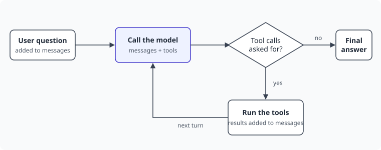

# The Chat Agent

Before we can observe an AI application, we need one. Ours is a small assistant for a
bookshop that answers questions about the catalog and the stock. It's only a couple of hundred
lines of Python, with no framework, but it has the same moving parts as much larger agents.

## Learning objectives

By the end of this module, you'll be able to:

- [ ] Explain how an agent loop works
- [ ] Describe how a model uses tools
- [ ] Say what can go wrong in a loop like this

## How a chat model works

A model is stateless. Each call sends the whole conversation as a list of messages, each
with a role, and gets one new message back.

| Role | Who wrote it |
|---|---|
| `system` | The application, with instructions for the model |
| `user` | The person chatting |
| `assistant` | The model |
| `tool` | The application, with the result of a tool |

The API reports how many **tokens** each call used, which is what you pay for. Because the
whole conversation is sent every time, input tokens grow with each turn.

## Tools

A model can't look anything up by itself, so the application offers it **tools**, each
described by a name, some text and a schema for its arguments. Here's one:

<!-- include: exercises/04-the-chat-agent/tools.py lines=42-54 -->

The model never runs anything. When it wants a tool, its response is a message asking for
one, with the arguments to use. Running the tool and sending back the result is the
application's job.

## The agent loop

That exchange is what makes an agent: the application keeps calling the model and running
tools until the model has a final answer.



Asked whether a book is in stock, our agent takes three turns:

| Turn | The model says | The application does |
|---|---|---|
| 1 | Call `search_books` with the title | Searches, and sends back the matches |
| 2 | Call `check_stock` with the book's id | Checks, and sends back the copies |
| 3 | "Yes, we have 12 copies" | Shows the answer to the user |

Notice that one question became three model calls and two tool calls. Remember that when
we get to the numbers.

## The application

The application has four small files:

| File | What it does |
|---|---|
| `chat.py` | The chat in your terminal |
| `agent.py` | The agent loop, which you'll finish |
| `tools.py` | The two tools, and their descriptions for the model |
| `llm.py` | The connection to the model, using the settings from your `llm.env` |

The tools are simple, and they work on data kept in memory:

<!-- include: exercises/04-the-chat-agent/tools.py lines=21-37 -->

## Exercise: finish the loop

This module's files are in `exercises/04-the-chat-agent`. Run the commands from `stack`,
as always.

1. Run the application as it is:

   ```bash
   docker compose exec agent python 04-the-chat-agent/chat.py --ask "Is The Trace of Time in stock?"
   ```

   The answer is empty, or it's a guess. The model asked for a tool, and nobody answered.

2. Open `agent.py`, and find `run_agent`:

   <!-- include: exercises/04-the-chat-agent/agent.py lines=33-50 -->

3. Repeat the call at most `MAX_TURNS` times.
4. When the model asks for tools, run each one with `call_tool`, and add its result to
   `messages`.
5. When it doesn't, return its answer.
6. If the turns run out, raise `TooManyTurns`.

> [!HINT] What does the loop look like?
> Put everything inside `for _ in range(MAX_TURNS):`. Check `message.tool_calls` right after
> adding the model's message to the list, and return if it's empty. The `raise` goes after
> the loop, where you only get if no turn returned.

> [!SOLUTION]
> <!-- include: exercises/04-the-chat-agent/solution/agent.py lines=33-54 -->

### Verify the result

- [ ] This answers with the number of copies, 12:

  ```bash
  docker compose exec agent python 04-the-chat-agent/chat.py --ask "Is The Trace of Time in stock?"
  ```

- [ ] Running it without `--ask` gives you a conversation. Ask about a book, then ask a
  follow-up, such as "who wrote it?". Press Ctrl+D to leave.
- [ ] A book that isn't in the catalog gets an honest "no", like "Do you sell Moby Dick?".

Now try this one, and look closely at the answer:

```bash
docker compose exec agent python 04-the-chat-agent/chat.py --ask "How many copies of Cardinality Explosion do you have?"
```

Something is wrong, but you may not be able to tell. With a real model, the answer is
probably a polite one, and it could even be made up. You'll come back to this at the end of
the workshop.

## What could go wrong?

Take a moment to think about what you couldn't answer about this application right now.

- How long does a question take, and is the time spent in the model or in the tools?
- How many tokens does a question cost? What about at the 95th percentile?
- Does the agent ever loop? How many turns does it usually take?
- Do tools fail? Would you notice, when the model covers up for them?
- What did the model actually see and say, when a user complains?

Every one of these questions has an answer in telemetry.

## Key takeaways

- Models are stateless: the application sends the whole conversation on each call.
- Models only ask for tools. The application runs them and sends back the results.
- An agent is a loop around those two things, so one question means several model calls.
- A failure inside the loop doesn't have to reach the user, or look like a failure at all.
