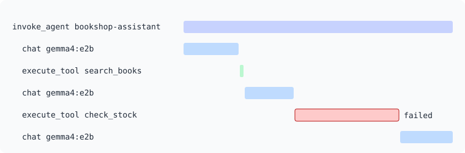

# Traces

You now know how much, and what happened. What's missing is how one run unfolded. Metrics
and events describe each step on its own, but an agent's behavior lies in the sequence: what
the model asked for, what came back, what it did next. Traces show exactly that, and adding
them will also connect everything you've built so far.

## Learning objectives

By the end of this module, you'll be able to:

- [ ] Build a span tree that matches an agent's structure
- [ ] Name spans and choose their kinds according to the conventions
- [ ] Record failures on spans
- [ ] Follow a run through a trace, and link its logs to it

## The shape of an agent trace

One run of the agent is one trace, with this structure:



The `chat` and `execute_tool` spans are siblings, not nested in each other, because that's
how the loop works: the model call has finished by the time a tool runs. A trace of an agent
reads from top to bottom as a transcript of what it did.

The conventions define each span:

| Span | Name | Kind |
|---|---|---|
| One agent run | `invoke_agent {gen_ai.agent.name}` | `INTERNAL` |
| One model call | `{gen_ai.operation.name} {gen_ai.request.model}`, so `chat gemma4:e2b` | `CLIENT` |
| One tool call | `execute_tool {gen_ai.tool.name}` | `INTERNAL` |

The kind tells you where the work happens. A model call goes to another service, so it's a
`CLIENT` span. The agent and its tools run in our own process, so they're `INTERNAL`.

> [!NOTE]
> If your agent is a remote service that you call, the conventions have a separate
> `gen_ai.client.invoke_agent` span for that. Ours runs in-process.

### Attributes

The `chat` span starts with `inference_attributes()`, the same ones as the metrics, and adds
these:

| Attribute | When |
|---|---|
| `gen_ai.conversation.id` | At the start |
| `gen_ai.response.model` | With the response |
| `gen_ai.response.id`, `gen_ai.response.finish_reasons`, `gen_ai.usage.input_tokens`, `gen_ai.usage.output_tokens` | With the response. `response_attributes()` gives you these |
| `gen_ai.input.messages`, `gen_ai.tool.definitions`, `gen_ai.output.messages` | Only if `capture_on_spans()` |

The other two spans:

| Span | Attributes |
|---|---|
| `execute_tool` | `gen_ai.operation.name` (`execute_tool`), `gen_ai.tool.name`, `gen_ai.tool.type` (`function`), `gen_ai.tool.call.id`, `gen_ai.agent.name`, `gen_ai.conversation.id` |
| `invoke_agent` | `gen_ai.operation.name` (`invoke_agent`), `gen_ai.agent.name`, `gen_ai.request.model`, `gen_ai.conversation.id`, and the total `gen_ai.usage.input_tokens` and `gen_ai.usage.output_tokens` |

The `execute_tool` span also takes `gen_ai.tool.call.arguments` and
`gen_ai.tool.call.result`, only if `capture_on_spans()`.

Content attributes here are structured values, not JSON strings: you pass the list or the
dictionary as it is. The conventions now require this, and the Python SDK accepts it. How
they look depends on the backend: VictoriaTraces flattens a dictionary into dotted keys, so
the arguments of `check_stock` appear as `gen_ai.tool.call.arguments.book_id`.

`gen_ai.tool.call.id` is the identifier that the model gave the call. It links this span to
the `tool_call` in the model's response.

### Failures on spans

A failed span needs two things: a status of `ERROR`, and `error.type`. The starter has a
helper for it:

<!-- include: exercises/08-traces/agent.py lines=45-47 -->

By default, `start_as_current_span` also adds the exception to the span as a span event.
We already emit an exception event of our own, so you'll pass `record_exception=False` to
avoid recording it twice.

## Exercise: add the spans

This module's files are in `exercises/08-traces`. This time all the setup is ready: `telemetry.py`
sets up traces as well, and the top of `agent.py` already has the imports, a `tracer`, and
`mark_failed`. `genai_events.py` adds `capture_on_spans`.

Only `agent.py` changes. Work from the inside out, starting with the simplest function:

1. **TODO 1**: Wrap `call_model` in a `chat` span. Keep the metrics and events you already
   have, inside the span.

   > [!HINT] Starting the span
   > Pass the kind and the initial attributes when you start the span:
   >
   > ```python
   > with tracer.start_as_current_span(
   >     f"chat {MODEL}",
   >     kind=SpanKind.CLIENT,
   >     attributes=inference_attributes(),
   >     record_exception=False,
   > ) as span:
   > ```

   > [!SOLUTION]
   > <!-- include: exercises/08-traces/solution/agent.py lines=50-82 -->

2. **TODO 2**: Wrap `call_tool` in an `execute_tool` span. It now needs a
   `conversation_id`, which the starter already passes.

   > [!SOLUTION]
   > <!-- include: exercises/08-traces/solution/agent.py lines=85-117 -->

3. **TODO 3**: Wrap `run_agent` in an `invoke_agent` span. Because it's current while the
   loop runs, the other two spans become its children with no extra code. Add up the tokens
   of each model call, and set the totals when the run ends.

   > [!SOLUTION]
   > <!-- include: exercises/08-traces/solution/agent.py lines=120-172 -->

> [!TIP]
> Should the metric and the span agree? The conventions say that the value of a duration
> metric should match the duration of its span. Keep your measurement inside the span, as
> close as you can to the work, and they'll be very close.

### Run it

```bash
docker compose exec -e OTEL_INSTRUMENTATION_GENAI_CAPTURE_CONTENT=SPAN_ONLY agent \
  python 08-traces/traffic.py
```

### Verify the result

Give the traces up to a minute to appear, then open Explore in Grafana. Choose the
VictoriaTraces data source, choose **Search**, pick `bookshop-agent` as the service, and run
the query. You'll get one trace per question.

- [ ] Open a trace with six spans, which is a run that found a book. It should have the shape
  of the diagram above.
- [ ] Open the `chat` spans in order, and read `gen_ai.output.messages`. You should see the
  model ask for a tool, then another, and then give its answer.
- [ ] Check the input tokens on each `chat` span. They go up, turn after turn, and the
  `invoke_agent` span has the total.
- [ ] Find a run where the `check_stock` span failed, which shows an error icon. How much of
  the run did it take?

### The signals connect

Here's the payoff. You didn't change a single line of your logging code in this module, but
your events were emitted while a span was current, so the SDK linked them.

- [ ] Run this in VictoriaLogs:

  ```logsql
  event_name:"gen_ai.execute_tool.exception" | fields _time, trace_id, span_id, exception.message
  ```

The events from the previous module have no `trace_id`, while the new ones have one. Copy a
`trace_id`, go back to VictoriaTraces, switch to the **TraceID** query type, and paste it.
You've just gone from a log record to the full story of that run.

Now try it the other way. This shows everything logged during one run, in order:

```logsql
trace_id:"<paste it here>" | fields _time, event_name, span_id
```

> [!TIP] Going further
> The conventions recommend `gen_ai.tool.description` on `execute_tool` spans. Add it, using
> the descriptions in `TOOLS`.

## Key takeaways

- An agent trace is an `invoke_agent` span, with `chat` and `execute_tool` children in the
  order they happened.
- Model calls are `CLIENT` spans, while the agent and its tools are `INTERNAL`.
- A failed span has an `ERROR` status and an `error.type`.
- Anything emitted during a span is linked to it, which ties logs and traces together for
  free.
